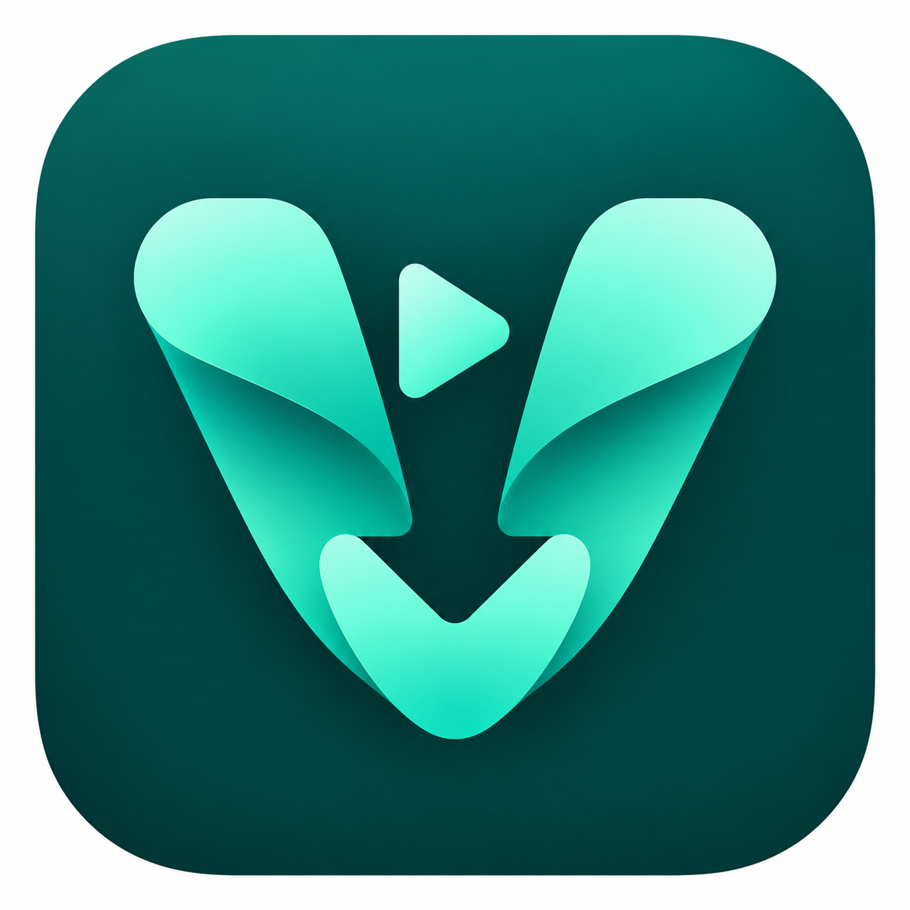

# ویدورا

لینک ویدیو را وارد کنید، کیفیت را انتخاب کنید و فایل را روی کامپیوترتان ذخیره کنید. ویدورا به فارسی، عربی، انگلیسی و چینی در دسترس است.

[English](README.md) · [العربية](README.ar.md) · [中文](README.zh.md)

## روش استفاده

۱. لینک را وارد کنید و «بررسی لینک» را بزنید.
۲. کیفیت، فرمت فایل و پوشهٔ ذخیره را انتخاب کنید.
۳. دانلود را شروع کنید. می‌توانید چند ویدیو را در صف بگذارید، دانلود را لغو کنید یا دوباره تلاش کنید.

عنوان، تصویر و کیفیت‌های موجود نمایش داده می‌شوند. اگر سایت اندازهٔ فایل را مشخص کرده باشد، حجم دانلود هم نشان داده می‌شود. صدا و تصویرِ جدا در یک فایل ذخیره می‌شوند. فرمت WebM برای کیفیت‌هایی در دسترس است که با آن سازگار باشند.

ویدیوها روی دستگاه خودتان ذخیره می‌شوند و برای استفاده از ویدورا نیازی به حساب ندارید. برنامه برای بررسی و دانلود، به سایت ویدیو وصل می‌شود. اگر سایتی به ورود نیاز داشته باشد، می‌توانید فایل کوکی همان سایت را انتخاب کنید. [راهنمای کوکی](docs/COOKIES.fa.md) مراحلش را توضیح می‌دهد.

ممکن است تغییرات سایت، خصوصی‌بودن ویدیو، لینک منقضی، محدودیت منطقه‌ای یا DRM مانع دانلود شوند. استفاده از کوکی هم دانلود همهٔ لینک‌ها را تضمین نمی‌کند.

## امکانات دانلود

برای چند دانلود، هر لینک را در یک خط وارد کنید و «بررسی و افزودن همه لینک‌ها به صف» را بزنید. شکست یک لینک مانع بقیه نمی‌شود. صف با باز کردن دوبارهٔ برنامه بازیابی می‌شود؛ برای ادامه، دکمهٔ «ادامه دانلود» را بزنید. توقف موقت و شکست، فایل نیمه‌کاره را نگه می‌دارند؛ لغو آن را حذف می‌کند. ادامهٔ واقعی به پشتیبانی سرور و تغییر نکردن جریان رسانه وابسته است.

پروفایل‌های آپارات، یوتیوب، اینستاگرام، ایکس، تیک‌تاک، فیس‌بوک و ویمئو تنظیمات لازم را به استخراجگرهای yt-dlp اضافه می‌کنند. سایت‌های دیگر همچنان با yt-dlp بررسی می‌شوند. در «تنظیمات پیشرفته» می‌توانید هدر، User-Agent، Referer، انتخابگر فرمت و روش استخراج را تعیین کنید. این تنظیمات با بررسی بعدی لینک به آن مورد از صف متصل می‌شوند. جایگزینی کیفیت هم‌سطح یا پایین‌تر فقط با فعال کردن گزینهٔ مربوط انجام می‌شود.

گزارش فنی هر مورد از دکمهٔ «گزارش فنی» قابل مشاهده، کپی و ذخیره است. آدرس‌ها و اطلاعات حساس نشست از گزارش حذف می‌شوند. گزارش‌ها تا حدود یک مگابایت برای هر مورد و حداکثر ۱۰۰ مورد نگه‌داری می‌شوند. صف و گزارش‌ها در پوشهٔ داده‌های برنامه در سیستم‌عامل ذخیره می‌شوند. محتوای کوکی و هدرهای نشست در صف ذخیره نمی‌شود؛ پس از باز کردن دوبارهٔ برنامه، در صورت نیاز آن‌ها را دوباره انتخاب کنید.

بخش «نسخه و سلامت موتور» عمر نسخهٔ نصب‌شده را بررسی می‌کند و پس از ۹۰ روز هشدار می‌دهد. با دکمهٔ بررسی نسخه جدید می‌توانید آخرین انتشار رسمی yt-dlp را هم بررسی کنید. به‌روزرسانی با نصب بستهٔ جدید ویدورا انجام می‌شود. زبان انتخابی و پوستهٔ روشن/تیره نیز ذخیره می‌شوند.

## نصب

نسخهٔ کد **۰.۲.۰**. فایل‌های آماده در پوشهٔ `dist` قرار می‌گیرند:

- **مک با Apple Silicon:** فایل DMG را باز کنید و ویدورا را به Applications بکشید.
- **لینوکس x64:** بستهٔ DEB را روی اوبونتو یا دبیان نصب کنید، یا نسخهٔ قابل‌حمل را از حالت فشرده خارج کنید.
- **ویندوز x64:** بستهٔ ساخت شامل کد و ابزارهای دانلود است. آن را به ویندوز ببرید تا فایل نصب EXE و نسخهٔ ZIP ساخته شوند.

ابزارهای دانلود داخل بستهٔ کامل برنامه هستند و نصب جداگانه نمی‌خواهند. اگر کد را از گیت می‌گیرید، باید ابتدا این ابزارها را آماده کنید. مراحل ساخت در [راهنمای ساخت](docs/BUILD.md) و نتیجهٔ بررسی‌ها در [گزارش آزمون](docs/VALIDATION.md) آمده است. نسخهٔ اندروید هنوز آماده نیست.

## دربارهٔ ویدورا

توسعه‌دهنده: **ذوالفقاری**. اگر ویدورا برایتان مفید بوده، می‌توانید از طریق دکمهٔ قلب برنامه یا [صفحهٔ حمایت](docs/SUPPORT.md) به ادامهٔ توسعه کمک کنید. حمایت اختیاری است و همهٔ امکانات رایگان هستند.

کد ویدورا با [مجوز MIT](LICENSE) منتشر شده است. ابزارها و فونت‌ها مجوزهای خودشان را دارند؛ جزئیات در [اعلان مجوزها](THIRD_PARTY_NOTICES.md) آمده است.
